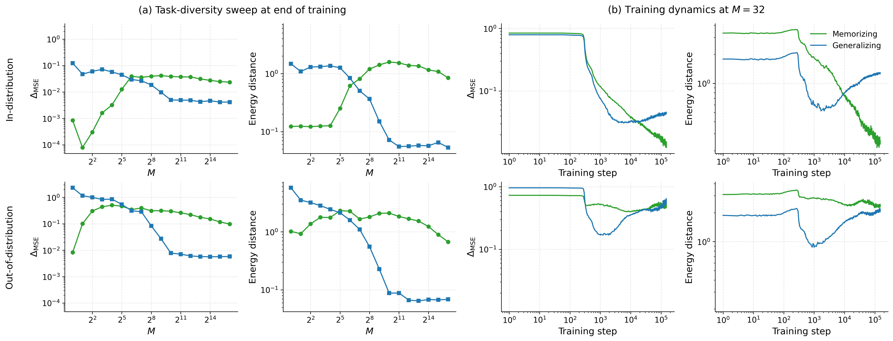

# BFT-PMC: Predictive Monte Carlo for Bayes-filtered transformers

Code for *What does a Bayes-filtered transformer believe? A predictive Monte
Carlo approach* (Aswadi, Ma and Wei, NeurIPS 2026). This is the camera-ready
release; [Camera-ready release](#camera-ready-release) lists what changed since
the initial public release.

A **Bayes-filtered transformer** (BFT) is trained on sequences generated in two
steps: draw a latent task from a prior, then draw observations given the task.
**Predictive Monte Carlo** (PMC) uses only next-token generation to recover an
approximation to the prior and posterior over the task that the trained model
has implicitly learned, so the model can be compared with candidate Bayesian
references in latent space rather than only through its predictions. This
repository applies PMC to task-diversity and training-dynamics experiments in
three task families:

- **linear regression** with a finite pool of Gaussian weight vectors;
- **balls and urns** with a finite pool of Dirichlet urns;
- **1-Markov chains** with a finite pool of transition matrices.

The first two are exchangeable, prior-fitted-network (PFN) settings; the third
extends the analysis to 1-Markov exchangeability. A continuous-prior
Beta-Bernoulli model illustrates the method (Figure 1).



*Linear regression: agreement with the memorizing (green) and generalizing
(blue) Bayesian references across task diversity M (left) and over training
at M = 32 (right), from the frozen data in `paper_data/`.*

## Contents

- [Installation](#installation)
- [Quick start](#quick-start)
- [Repository layout](#repository-layout)
- [Commands](#commands)
- [Reproducing the paper](#reproducing-the-paper)
- [Running the experiments](#running-the-experiments)
- [Tests](#tests)
- [Camera-ready release](#camera-ready-release)
- [Supplementary material](#supplementary-material)
- [Citation](#citation)

## Installation

Python 3.13 or newer and [`uv`](https://docs.astral.sh/uv/):

```bash
git clone https://github.com/afiq-aswadi/bft-pmc.git
cd bft-pmc
uv sync
```

`uv sync` creates `.venv/` and installs the `bft_pmc` package in editable mode
together with the PFN library vendored under
[`pfn_transformers/`](pfn_transformers/README.md). Without uv,
`pip install -r requirements.txt` gives the same environment, unpinned.

Weights & Biases logging is optional and off by default: install it with
`uv sync --extra wandb`, set `WANDB_PROJECT` and `WANDB_ENTITY`, and pass
`--use-wandb` to a training command. Nothing else contacts the network.

## Quick start

```bash
uv run eval.py --help              # every evaluation, diagnostics and figure command
uv run train.py --help             # every training setting

# Redraw the paper figures the committed data supports (CPU only, minutes).
bash scripts/reproduce_paper.sh    # -> outputs/paper_reproduction/

# Train tiny models: API smoke tests, not meaningful runs.
uv run train.py lr --num-tasks 32 --num-steps 10 --batch-size 8 --seq-len 16 --n-ctx 32 --save-every 5 --no-use-wandb
uv run train.py bau --num-tasks 32 --num-steps 10 --batch-size 8 --seq-len 16 --save-every 5 --no-use-wandb
uv run train.py markov --config-path configs/markov/train.yaml --n-chains 32 --max-steps 10 --no-use-wandb
```

Linear-regression and balls-and-urns training checkpoints every `--save-every`
steps (500 by default), so short runs need a smaller interval to write one.

## Repository layout

```text
train.py, eval.py            the two entry points; they dispatch to the modules below
bft_pmc/                     the Python package
  linear_regression/         priors, references, PMC estimator, training, evaluation, figures
  balls_and_urns/            the same for balls and urns, plus the Beta-Bernoulli experiment
  markov/                    the same for 1-Markov chains, with its own small transformer
  analysis/                  cross-family tools: checkpoint and rollout I/O, the PMC reliability
                             diagnostics (Appendix D), next-token fidelity, reliability figures
  plotting/                  shared paper typography and marginal-density rendering
  metrics.py                 energy distance, sliced Wasserstein, symmetrised KL
  pos_encoding.py            learned / rotary / no positional encoding
  cli.py                     the command table behind train.py and eval.py
  sweep_runner.py            YAML sweep launcher (train.py sweep)
configs/                     Markov training defaults and the three paper sweep definitions
paper_data/                  frozen figure inputs: metrics tables, evaluation prompts, a small model
docs/                        figure provenance, checkpoint layout, output formats
scripts/                     reproduction and figure-rebuild scripts; cluster sync helpers
slurm/                       SLURM jobs for every paper run, with their settings record
tests/                       test suite (100% line coverage)
pfn_transformers/            vendored PFN TransformerLens library, with its own tests
assets/                      README figure
icl2_supplementary.pdf       the paper's supplement: more reliability diagnostics, every PMC marginal
```

Each family package has a README listing its modules:
[linear regression](bft_pmc/linear_regression/README.md),
[balls and urns](bft_pmc/balls_and_urns/README.md),
[Markov](bft_pmc/markov/README.md),
[analysis](bft_pmc/analysis/README.md).

## Commands

Every experiment, diagnostic and figure is a command of `train.py` or
`eval.py`. Put `--help` after a command for its options; everything after the
command name is passed to it.

**Training** (`uv run train.py <setting>`):

| Setting | What it does |
| --- | --- |
| `lr` | train one linear-regression PFN on a finite Gaussian task pool |
| `bau` | train one balls-and-urns PFN on a finite Dirichlet urn pool |
| `markov` | train one 1-Markov transformer on a finite pool of transition matrices |
| `beta-bernoulli` | train the continuous-prior Beta-Bernoulli model, run PMC and draw Figure 1 |
| `sweep` | run a YAML sweep definition (`configs/sweeps/`) across local GPUs |

**Evaluation** (`uv run eval.py <command>`):

| Group | Commands |
| --- | --- |
| Evaluate checkpoints | `lr-sweep`, `bau-sweep`, `markov-sweep` (final checkpoint of every run in a task-diversity sweep); `lr-dynamics`, `bau-dynamics` (every checkpoint of one run); `markov-pmc` (one Markov checkpoint); `markov-threshold` |
| Prior-only metrics and evaluation data | `lr-prior-delta-mse`, `bau-prior-kl`, `markov-prior-kl` (the prediction-space panels of the prior figures); `bau-eval-dataset` (fixed balls-and-urns prompts) |
| PMC reliability diagnostics (Appendix D) | `lr-rollout-diagnostics`, `bau-rollout-diagnostics`, `markov-rollout-diagnostics` (recovery against rollout length and count, drift); `path-stability`; `recovery-vs-dimension`; `replot-pmc-diagnostics`; `predictive-fidelity`; `prior-shape` (Gaussian against Laplace prior); `bau-samples-count-panel`; `compare-pos-encodings` |
| Paper figures | `plot-lr-sweep`, `plot-lr-dynamics`, `plot-lr-prior`, `plot-lr-sweep-and-dynamics`, `plot-lr-marginals`, `plot-lr-stitched-marginals`, `plot-lr-single-marginal`, `plot-identifiability`; `plot-bau-sweep`, `plot-bau-dynamics`, `plot-bau-prior`, `plot-bau-marginals`, `plot-bau-stitched-marginals`; `plot-markov-sweep`, `plot-markov-dynamics`, `plot-markov-prior`, `plot-markov-marginals`; `plot-reliability` |

`uv run eval.py --help` prints the same list with a line on each command.

## Reproducing the paper

**From the repository alone.** `bash scripts/reproduce_paper.sh` redraws,
with no checkpoints, GPU or network:

- the Beta-Bernoulli figures (Figure 1 and the grid of Appendix E) and the
  identifiability example (Figure 2);
- the camera-ready linear-regression and balls-and-urns task-diversity
  figures and all 41 reliability figures of Appendix D and the supplement,
  from the inputs frozen in
  [`paper_data/camera_ready/`](paper_data/camera_ready/README.md), checked to
  render pixel-identical to the paper's;
- the aggregate task-diversity, prior and training-dynamics figures of all
  three families from the *original* runs in [`paper_data/`](paper_data/README.md).
  The camera-ready LR and balls-and-urns sweep and prior figures were instead
  drawn from the retrained runs (no positional encoding, 256-position
  contexts, 32-observation prompts).

**Everything else** needs outputs of the full experiments: the marginal
figures read PMC sample bundles, and the camera-ready prior panels the
sweeps' sidecar CSVs. The code that produces them is all here.
[`docs/figure_provenance.md`](docs/figure_provenance.md) lists, for every
figure in the paper and supplement, the command that draws it, its inputs and
where they live.

**Settings.** All three families use 256 positions, so a rollout is 32 prompt
observations plus N = 223 generated ones in every setting:

| Family | Context | Rollout after a 32-observation prompt |
| --- | --- | --- |
| Linear regression | `n_ctx = 512`: 256 interleaved (x, y) pairs | 224 pairs |
| Balls and urns | `n_ctx = 256`: BOS + 255 tokens | 223 tokens |
| 1-Markov | `seq_len = 256`: BOS + 255 states | 224 states |

The sweep evaluations draw 128 prompts with 100 rollouts each for the
posterior and 1024 rollouts for the prior, identically across families. The
reliability diagnostics also generate past the trained context, to N = 500,
by rebuilding each model with a longer context.
Linear-regression and balls-and-urns models are trained under three
positional encodings (`--pos-encoding learned`, `rope` or `none`); the Markov
model uses rotary embeddings throughout. The paper's runs use seed 42, and
seed 0 for Beta-Bernoulli. The exact commands are in
[`slurm/train.slurm`](slurm/train.slurm), and the diagnostics settings,
including how each positional encoding is extended, in
[`slurm/PMC_DIAGNOSTICS.md`](slurm/PMC_DIAGNOSTICS.md).

## Running the experiments

- **On a SLURM cluster**: [`slurm/README.md`](slurm/README.md) takes the
  task-diversity sweeps from training through evaluation to the path-stability
  plot, and submits the reliability diagnostics of Appendix D.
- **On a multi-GPU workstation**: the three paper sweeps are YAML definitions
  that `train.py sweep` expands and runs, one job queue per GPU:

  ```bash
  uv run train.py sweep configs/sweeps/lr_task_diversity_sweep.yaml --dry-run
  ```

  Remove `--dry-run` to launch. The training-dynamics figures reuse every
  saved checkpoint of the M = 32 (linear regression, balls and urns) and M = 8
  (Markov) runs, so they need no separate sweep.

Checkpoints go to `checkpoints/` and results to `outputs/`, both ignored by
git. [`docs/model_zoo.md`](docs/model_zoo.md) gives the checkpoint layout the
evaluation commands expect, and [`docs/pmc_outputs.md`](docs/pmc_outputs.md)
what every evaluation writes.

## Tests

```bash
uv sync --group dev
uv run pytest
```

The suite covers `bft_pmc`, the entry points and the vendored library, and
fails below 100% line coverage. It trains and evaluates tiny models on the CPU
and takes about two minutes. Lint and formatting settings are in
`pyproject.toml` (`uvx ruff check`, `uvx ruff format`).

## Camera-ready release

This version accompanies the camera-ready paper. Since the initial public
release (commit [`539deb3`](https://github.com/afiq-aswadi/bft-pmc/tree/539deb3),
July 2026) the repository has gained:

- the PMC reliability diagnostics of Appendix D and the supplement: path
  stability, and recovery against rollout length, rollout count, latent
  dimension and task diversity;
- the Gaussian-against-Laplace prior comparison of Appendix H.1
  (`eval.py prior-shape`);
- learned, rotary and no positional encoding for the linear-regression and
  balls-and-urns models (`--pos-encoding`);
- models retrained at the camera-ready settings (256 positions, 32-observation
  prompts), from which several figures were redrawn;
  [`docs/figure_provenance.md`](docs/figure_provenance.md) says which, and
  [`paper_data/camera_ready/`](paper_data/camera_ready/README.md) holds their
  inputs;
- the camera-ready supplement (next section).

The code also moved into the `bft_pmc` package. `train.py` and `eval.py` are
still the entry points, and every command of the initial release keeps its
name. Other paths changed:

| Initial release | Camera-ready |
| --- | --- |
| `linear_regression/`, `balls_and_urns/`, `markov/`, `analysis/`, `plotting/`, `metrics.py` | the same names under `bft_pmc/` |
| `uv run sweeps/run_yaml_sweep.py sweeps/configs/<sweep>.yaml` | `uv run train.py sweep configs/sweeps/<sweep>.yaml` |
| `markov/train.yaml`, `markov/task_diversity_threshold.yaml` | the same files under `configs/markov/` |
| `scripts/generate_bau_eval_dataset.py` | `eval.py bau-eval-dataset` |
| `scripts/compute_lr_prior_delta_mse.py`, `scripts/compute_bau_prior_predictive_kl.py`, `scripts/compute_markov_prior_predictive_kl.py` | `eval.py lr-prior-delta-mse`, `eval.py bau-prior-kl`, `eval.py markov-prior-kl` |
| `MODEL_ZOO.md`, `paper_data/FIGURE_PROVENANCE.md` | [`docs/model_zoo.md`](docs/model_zoo.md), [`docs/figure_provenance.md`](docs/figure_provenance.md) |

## Supplementary material

[`icl2_supplementary.pdf`](icl2_supplementary.pdf) is the paper's supplement.
Its first part extends the reliability diagnostics of Appendix D: prior and
posterior recovery against rollout length and count for each family at
horizon N = 223, for linear regression and balls and urns also at N = 500, and
for the learned and rotary positional-encoding models. The second part gives
every PMC-recovered marginal density and CDF for all three task families at
every task diversity; the paper shows a representative subset.

## Citation

```bibtex
@inproceedings{aswadi2026bft,
  title     = {What does a {Bayes}-filtered transformer believe? {A} predictive {Monte Carlo} approach},
  author    = {Aswadi, Afiq Abdillah Effiezal and Ma, Haotong and Wei, Susan},
  booktitle = {Advances in Neural Information Processing Systems},
  year      = {2026}
}
```

## License

MIT, including the vendored `pfn_transformers/` library; see [`LICENSE`](LICENSE).
